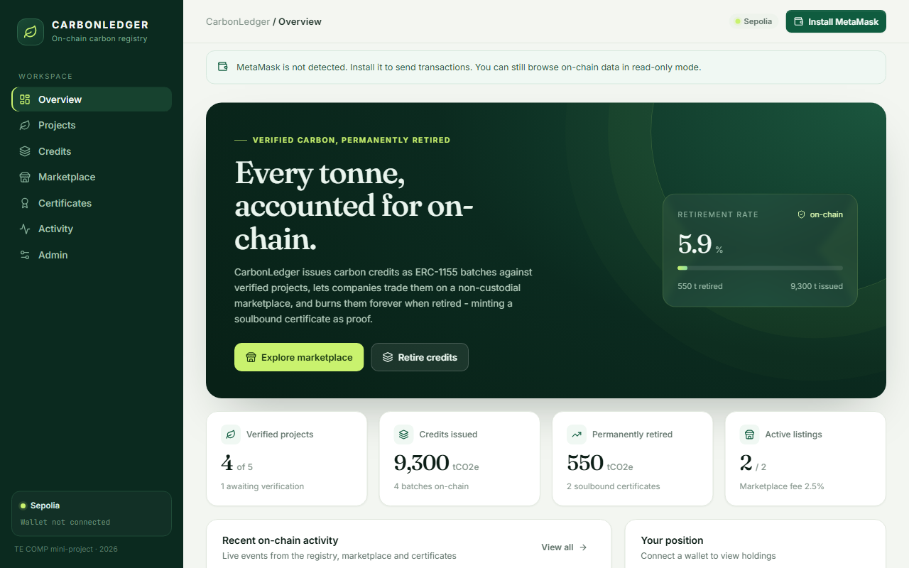

# CarbonLedger

**Decentralized Carbon Credit Tracking, Trading and Retirement System**

TE COMP Blockchain Mini-Project · Project #23 · Batch TE COMP 1 – C

CarbonLedger is a full-stack decentralized application (DApp) that manages the complete lifecycle of
carbon credits: project registration, verifier approval, credit issuance, peer-to-peer trading and
permanent retirement with an on-chain proof certificate.

Built with Solidity, OpenZeppelin, Hardhat, React, ethers.js and MetaMask. Deployable to the
**Sepolia testnet** or a local Hardhat node, and fully compatible with **Remix IDE** (flattened
contracts included).



_Live on the Sepolia testnet with seeded demo data._


## Live deployment (Sepolia)

| Contract | Address |
| --- | --- |
| ProjectRegistry | [`0xAe2aDBB46c37E48AF2F30062F53FdBfffc87C007`](https://sepolia.etherscan.io/address/0xAe2aDBB46c37E48AF2F30062F53FdBfffc87C007) |
| CarbonCreditToken (ERC-1155) | [`0xbD69c3Bc9E618aF87F575aE83Df99FbA97737AC9`](https://sepolia.etherscan.io/address/0xbD69c3Bc9E618aF87F575aE83Df99FbA97737AC9) |
| RetirementCertificate (ERC-721) | [`0x33eF38395655284Fb63a6906a17C1e9b6C7ea27F`](https://sepolia.etherscan.io/address/0x33eF38395655284Fb63a6906a17C1e9b6C7ea27F) |
| CarbonMarketplace | [`0x897d0A2E29feab3D6c59997D367432d0E382Df68`](https://sepolia.etherscan.io/address/0x897d0A2E29feab3D6c59997D367432d0E382Df68) |

Deployer / admin / treasury: [`0xC6Cb39464733118Bcfc38f7ca80E09A8DFc963Ea`](https://sepolia.etherscan.io/address/0xC6Cb39464733118Bcfc38f7ca80E09A8DFc963Ea)

The Sepolia deployment is already seeded with 5 projects (4 verified), 4 credit batches,
2 retirement certificates and 2 marketplace listings. Connect MetaMask to Sepolia to interact.

---

## Why this project

Carbon markets rely on trust. A credit must be:

1. issued only once, against a genuinely verified project;
2. traded transparently without a central custodian; and
3. retired permanently so it cannot be double-counted.

A conventional database can be edited silently. CarbonLedger puts each of those rules into smart
contract logic, so issuance caps, ownership, escrow and retirement are enforced by code and visible
to everyone. Retirement is irreversible and produces a **soulbound certificate** whose artwork and
metadata live entirely on-chain.

---

## Feature overview

| Area | What it does |
| --- | --- |
| Project registry | Register projects with a `keccak256` methodology-document hash, location, methodology and issuance capacity. Verifiers approve or revoke projects. |
| Credit issuance | Verified projects issue **ERC-1155** batches. Each batch = one project + vintage; balances are tonnes of CO2e. Duplicate serial hashes and over-capacity issuance revert. |
| Retirement | Holders burn credits permanently. A **soulbound ERC-721** certificate is minted to the beneficiary with on-chain SVG artwork and base64 JSON metadata. |
| Marketplace | Fixed-price listings with credits escrowed in the contract. Partial fills, 2.5% configurable fee (hard cap 10%), and pull-payment withdrawals. |
| Roles | OpenZeppelin `AccessControl`: admin, verifier, minter, pauser, plus marketplace admin. |
| Safety | `Pausable`, `ReentrancyGuard`, checks-effects-interactions, pull payments, role checks, input validation, issuance caps. |
| Transparency | Solidity events for every action, aggregated into a live activity feed with Etherscan links. |
| UX | React + Vite dashboard with role-aware navigation, MetaMask integration, transaction toasts, skeleton loading, empty states and responsive layout. |

---

## Architecture

```
 MetaMask ──► React DApp (Vite + ethers.js v6)
                    │
                    ├── reads ──►  Sepolia RPC
                    │
                    └── writes ─►  ProjectRegistry
                                   CarbonCreditToken (ERC-1155)
                                   RetirementCertificate (ERC-721)
                                   CarbonMarketplace
```

Full diagrams, data model and security notes: **[docs/ARCHITECTURE.md](docs/ARCHITECTURE.md)**

### Contracts

| Contract | Responsibility |
| --- | --- |
| `ProjectRegistry.sol` | Projects, document hashes, verifier approval/revocation, issuance-cap accounting. |
| `CarbonCreditToken.sol` | ERC-1155 credit batches, minting rules, transfers, permanent retirement. |
| `RetirementCertificate.sol` | Soulbound ERC-721 proof of retirement with fully on-chain metadata. |
| `CarbonMarketplace.sol` | Escrowed fixed-price listings, partial buys, fees, proceeds withdrawal. |

---

## Quick start (local Hardhat)

Requirements: Node.js 18+ (tested on 24), npm, MetaMask.

```bash
npm install
npm run compile
npm test

# Terminal 1 - local blockchain
npm run node

# Terminal 2
npm run deploy:local
npm run seed:local          # optional demo data
npm run export              # copies ABIs + addresses into the frontend

# Terminal 3
npm run frontend:install
npm run frontend            # http://localhost:5173
```

Then add the local network to MetaMask:

| Field | Value |
| --- | --- |
| RPC URL | `http://127.0.0.1:8545` |
| Chain ID | `31337` |
| Currency | ETH |

Import one of the private keys printed by `npm run node` to act as admin/issuer. Account **#0** is
the deployer and holds every role.

---

## Deploy to Sepolia (Hardhat)

1. Copy the environment file and fill it in:

   ```bash
   cp .env.example .env
   ```

   - `SEPOLIA_RPC_URL` — free endpoint from Alchemy / Infura / QuickNode.
   - `PRIVATE_KEY` — deployer wallet key (never commit `.env`).
   - Get Sepolia ETH from a faucet (e.g. https://sepoliafaucet.com).

2. Deploy, optionally seed demo data, and export the frontend config:

   ```bash
   npm run deploy:sepolia
   npm run seed:sepolia      # optional: creates 5 projects, 4 batches, 2 certificates, 2 listings
   npm run export
   ```

3. Restart the frontend (`npm run frontend`) or rebuild it (`npm run frontend:build`).

The deployment is saved to `deployments/sepolia.json` and copied into
`frontend/src/contracts/addresses.json` by `npm run export`.

4. Optional contract verification on Etherscan:

   ```bash
   npx hardhat verify --network sepolia <address> <constructor args...>
   ```

   Constructor arguments are printed by the deploy script / stored in `deployments/sepolia.json`.

> `npm run export` prefers `deployments/sepolia.json`, then `localhost.json`, then `hardhat.json`.

---

## Deploy with Remix IDE (no private key in the repo)

Single-file, dependency-free contracts are generated in **[remix/](remix/)** by:

```bash
npm run flatten
```

Compile settings in Remix: **Solidity 0.8.24**, **EVM version: cancun**, optimizer enabled (200 runs).

Deploy **in this order**, passing your own MetaMask address as `admin`:

| # | Contract | Constructor arguments |
| --- | --- | --- |
| 1 | `ProjectRegistry` | `admin = <your address>` |
| 2 | `RetirementCertificate` | `admin = <your address>` |
| 3 | `CarbonCreditToken` | `admin = <your address>`, `registry = <ProjectRegistry address>` |
| 4 | `CarbonMarketplace` | `admin = <your address>`, `credits = <CarbonCreditToken address>`, `treasury = <your address>` |

Then wire the system (each call must come from the admin account):

| # | Call | Arguments |
| --- | --- | --- |
| 5 | `ProjectRegistry.grantRole` | `role = CREDIT_TOKEN_ROLE`, `account = <CarbonCreditToken>` |
| 6 | `RetirementCertificate.grantRole` | `role = MINTER_ROLE`, `account = <CarbonCreditToken>` |
| 7 | `CarbonCreditToken.setCertificateContract` | `<RetirementCertificate>` |

The deployer already receives `MINTER_ROLE` on the token, so batches can be issued immediately.
To let another wallet issue credits, call `CarbonCreditToken.grantRole(MINTER_ROLE, <issuer>)`.

Finally create `deployments/sepolia.json` with the addresses below and run `npm run export`:

```json
{
  "network": "sepolia",
  "chainId": 11155111,
  "deployer": "0xYourAddress",
  "treasury": "0xYourAddress",
  "deployedAt": "2026-11-25T00:00:00.000Z",
  "deploymentBlock": 0,
  "contracts": {
    "ProjectRegistry": "0x...",
    "RetirementCertificate": "0x...",
    "CarbonCreditToken": "0x...",
    "CarbonMarketplace": "0x..."
  }
}
```

`deploymentBlock: 0` makes the activity feed scan from genesis. Set the actual block number to make
the feed faster.

---

## Using the DApp

| Role | What they can do |
| --- | --- |
| **Viewer** (any wallet) | Browse projects, credits, listings and certificates; hold, retire and trade credits. |
| **Verifier** (`VERIFIER_ROLE`) | Verify or revoke projects. |
| **Issuer** (`MINTER_ROLE`) | Issue credit batches for verified projects. |
| **Admin** (`DEFAULT_ADMIN_ROLE`) | Grant/revoke all roles, change marketplace fee/treasury, withdraw fees, pause contracts. |
| **Pauser** (`PAUSER_ROLE`) | Emergency pause/unpause. |

Demo flow:

1. **Projects** → register a project (any wallet).
2. **Projects** → as verifier, click **Verify**.
3. **Credits** → as issuer, **Issue batch** against the verified project.
4. **Credits** → **Sell** part of the batch (approve marketplace, then list).
5. **Marketplace** → switch wallet and **Buy credits**.
6. **Credits** → **Retire** credits for a beneficiary; view the certificate under **Certificates**.
7. **Admin** → grant roles, change fee, pause/unpause.

Step-by-step demo and negative tests: **[docs/DEMO_SCRIPT.md](docs/DEMO_SCRIPT.md)**

---

## Tests

```bash
npm test
```

**31 automated tests** cover project registration and verification, access control, duplicate
documents, issuance caps, duplicate serials, retirement, soulbound enforcement, on-chain metadata,
marketplace escrow, partial buys, fees, cancels, withdrawals, pausing and invalid inputs.

Details: **[docs/TEST_CASES.md](docs/TEST_CASES.md)**

---

## Project layout

```
contracts/                 Solidity contracts
test/                      Hardhat test suite (31 tests)
scripts/                   deploy, seed, export, flatten
remix/                     Flattened single-file contracts for Remix
frontend/                  React + Vite DApp
  src/contracts/           ABIs + addresses.json (generated)
  src/context/             wallet, refresh, toast providers
  src/hooks/               useQuery, useRoles, useTx
  src/lib/                 chain config, events, holdings, formatting
  src/pages/               Overview, Projects, Credits, Marketplace, Certificates, Activity, Admin
docs/                      Architecture, demo script, test cases, viva Q&A
deployments/               Deployment addresses per network (generated)
```

---

## Security notes

- Role checks on every privileged function (`AccessControl`).
- Issuance capped by project capacity; duplicate serial hashes rejected.
- Retirement burns credits before minting the certificate (checks-effects-interactions).
- Marketplace uses escrow + pull payments and `nonReentrant` on all value-moving functions.
- Fee hard-capped at 10%; treasury and fee changes admin-only.
- Pausable registry, token and marketplace.
- Document contents never go on-chain — only `keccak256` hashes.
- Secrets live in `.env`, which is git-ignored.

Known limitations (honest scope): fixed-price ETH listings, a lifetime issuance cap per project
rather than an automatic yearly reset, event scanning bounded to the deployment block, and admin
role management rather than a full DAO.

---

## Tech stack

Solidity 0.8.24 · OpenZeppelin Contracts 5.x · Hardhat 2 · ethers.js v6 · React 18 · Vite 6 ·
MetaMask · Sepolia · GitHub Actions

---

## Team

| | |
| --- | --- |
| Student 1 | Adarsh Maurya — 2414002 |
| Student 2 | _to be confirmed_ |
| Batch | TE COMP 1 – C |
| Project | #23 — Decentralized Carbon Credit Tracking and Trading System |

Submission details and abstract: **[SUBMISSION.md](SUBMISSION.md)**
