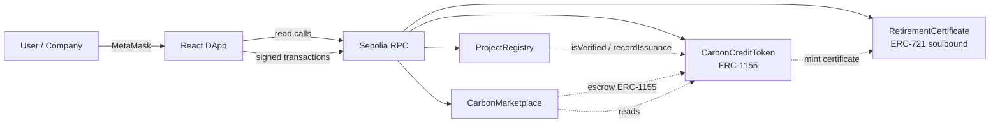
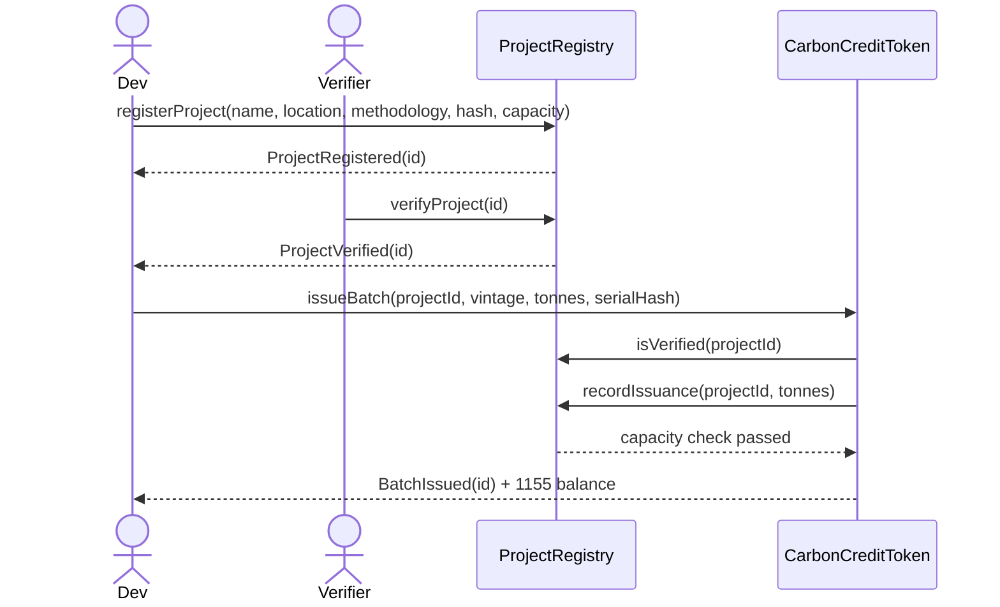
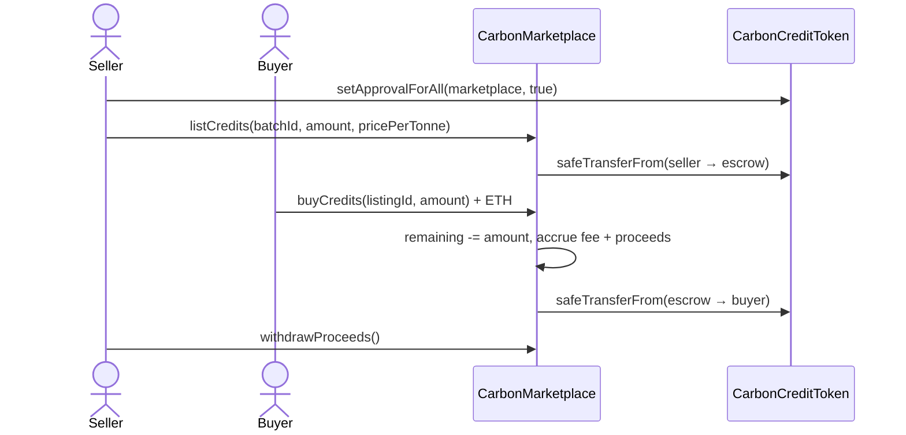
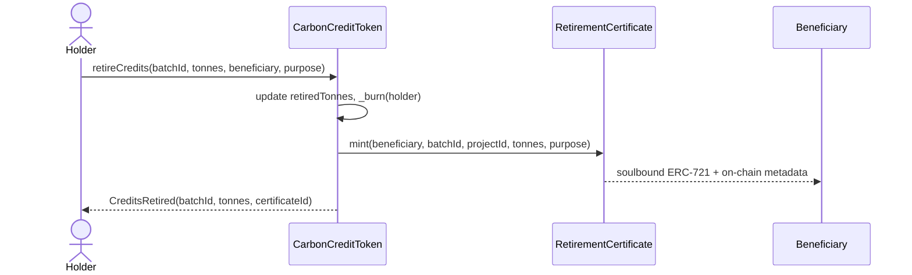
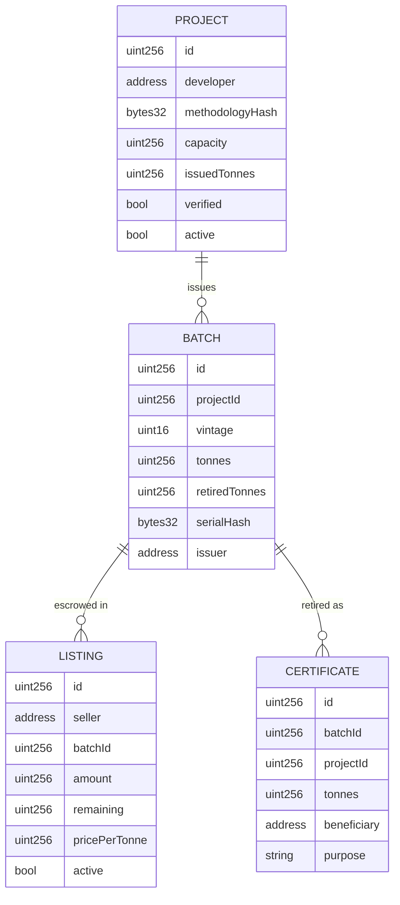

# Architecture

CarbonLedger separates **registry**, **asset**, **proof** and **market** concerns into four
contracts. Each contract has a single responsibility, which keeps the attack surface small and the
viva explanation simple.

---

## 1. System context



The frontend never holds private keys. MetaMask signs every state-changing call; ethers.js encodes
it against the exported ABI. Reads use a public RPC provider so the app is browsable without a
wallet.

---

## 2. Contract responsibilities

### ProjectRegistry

- Stores `Project { id, developer, name, location, methodology, methodologyHash, capacity,
  issuedTonnes, verified, active, createdAt, verifiedAt }`.
- `registerProject` — any wallet; rejects empty values and duplicate document hashes.
- `verifyProject` / `revokeVerification` / `setProjectActive` — `VERIFIER_ROLE`.
- `recordIssuance` — callable only by `CarbonCreditToken` (`CREDIT_TOKEN_ROLE`); enforces capacity.
- Emergency `pause` / `unpause` — `PAUSER_ROLE`.

### CarbonCreditToken (ERC-1155)

- One token id per batch: `Batch { projectId, vintage, tonnes, retiredTonnes, serialHash, issuer }`.
- Balances are tonnes of CO2e, so a batch is fungible within itself while remaining distinct from
  other projects/vintages.
- `issueBatch` — `MINTER_ROLE`; requires a verified project, unique serial hash and available
  capacity.
- `retireCredits` — burns the holder's credits, then asks the certificate contract to mint a proof.
- `_update` is `whenNotPaused`, so transfers, mints and burns stop during an emergency.

### RetirementCertificate (ERC-721)

- Soulbound: `_update` requires `from == address(0)`, so tokens can be minted but never transferred
  or burned.
- `tokenURI` builds JSON (attributes + base64 SVG image) entirely on-chain — no IPFS or server.
- Only the token contract holds `MINTER_ROLE`.

### CarbonMarketplace

- Seller approves the marketplace, then `listCredits` escrows the ERC-1155 amount.
- `buyCredits` supports partial fills. Payment must equal `amount * pricePerTonne`.
- Fees accrue to `accruedFees`; seller proceeds accrue to `proceeds[seller]`.
- Both are withdrawn with pull payments (`withdrawProceeds`, `withdrawFees`), which removes
  reentrancy/gas-griefing risk from the buy path.
- Implemented as an `IERC1155Receiver` so it can hold escrowed credits.

---

## 3. Lifecycle flows

### 3.1 Register → verify → issue



### 3.2 Buy from the marketplace



### 3.3 Retire → certificate



---

## 4. Data model



`ProjectRegistry` owns project data. `CarbonCreditToken` stores batch metadata and references
`projectId`. Certificates duplicate the minimum fields needed for a self-contained proof, so the
certificate remains meaningful even if frontends change.

---

## 5. Roles

| Role | Registry | Token | Certificate | Marketplace |
| --- | --- | --- | --- | --- |
| `DEFAULT_ADMIN_ROLE` | grant roles, unpause | grant roles | grant roles | fee, treasury, withdraw fees |
| `VERIFIER_ROLE` | verify / revoke / activate | — | — | — |
| `MINTER_ROLE` | — | issue batches | — | — |
| `PAUSER_ROLE` | pause | pause | — | pause |
| `CREDIT_TOKEN_ROLE` | record issuance | — | — | — |

The deployer receives all admin roles. In a real deployment the registry admin would be a
multi-signature wallet, and verifiers/issuers would be separate organisations.

---

## 6. Security design

| Threat | Mitigation |
| --- | --- |
| Unauthorised verification | `onlyRole(VERIFIER_ROLE)` |
| Unauthorised minting | `onlyRole(MINTER_ROLE)` + `registry.isVerified` |
| Over-issuance | `recordIssuance` enforces `issuedTonnes + tonnes <= capacity` |
| Duplicate credits | Unique `serialHash` mapping + unique token ids |
| Double retirement | Credits are burned; retirement is irreversible |
| Reentrancy in marketplace | `nonReentrant` + checks-effects-interactions + pull payments |
| Fake listings | Credits are escrowed before a listing becomes active |
| ERC-1155 receiver traps | `onERC1155Received` implemented; no arbitrary calls |
| Fee abuse | Hard cap `MAX_FEE_BPS = 1000` (10%) |
| Emergency | `Pausable` on registry, token, marketplace |
| Sensitive data leaks | Only hashes are stored on-chain (methodology, serial, purpose text is non-sensitive) |
| Spoofed ownership | Certificates are soulbound and derived from contract state |

---

## 7. Frontend architecture

```
WalletProvider   → MetaMask connection, chain detection, signer + read provider
RefreshProvider  → global refresh key; every write triggers a refetch
ToastProvider    → pending / confirmed / failed transaction notifications
App              → hash-based routing, error boundary, deployment guard
Layout           → sidebar, wallet menu, network switch, mobile drawer
Pages            → Overview, Projects, Credits, Marketplace, Certificates, Activity, Admin
Hooks            → useQuery (async reads), useRoles (AccessControl), useTx (write wrapper)
Lib              → chain config, event aggregation, holdings derivation, formatting
```

Because ERC-1155 has no enumeration, **holdings** are derived from `TransferSingle` logs for the
connected account, then live `balanceOf` values are read. **Activity** aggregates events from all
four contracts between the deployment block and the latest block, in 45k-block chunks.

---

## 8. Design decisions and trade-offs

| Decision | Reason | Trade-off |
| --- | --- | --- |
| ERC-1155 instead of ERC-20/721 | Tonnes are fungible per batch; partial retirement is native; batches stay distinct | Requires approval-for-all and log-derived enumeration |
| Retirement burns credits | Guarantees no double counting | No undo; a mistaken retirement is permanent by design |
| Soulbound certificate | Proof cannot be sold or transferred away from the beneficiary | Beneficiary cannot move it to another wallet |
| On-chain SVG metadata | No IPFS pinning or external dependency | Higher `tokenURI` gas (view call, not a transaction) |
| Fixed-price ETH marketplace | Simple, auditable, no oracle | No auctions or dynamic pricing |
| Pull payments | Avoids reentrancy and failed-transfer griefing | Sellers need an extra withdraw transaction |
| Lifetime capacity cap | Simple rule that is easy to audit | Not an automatic annual reset |

---

## 9. Deployment topology

- **Local:** Hardhat node, chain 31337, deterministic addresses, seeded demo data.
- **Testnet:** Sepolia, chain 11155111, verified on Etherscan (optional).
- **Frontend:** static Vite build; can be hosted on GitHub Pages, Vercel or Netlify.

`scripts/export-frontend.js` copies the ABIs and the newest deployment into
`frontend/src/contracts/`, so the UI always matches the deployed bytecode.
